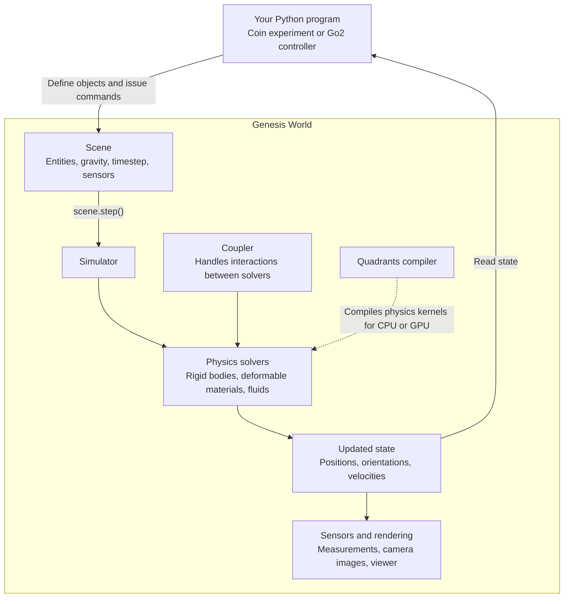

https://github.com/user-attachments/assets/2c857a52-bca0-4b52-ae38-52206615a5d1

# Genesis Probability Lab

A coin and a die tossed inside a physics simulation, to see how often each face lands.

This repository is a personal fork of **[Genesis World](https://github.com/Genesis-Embodied-AI/genesis-world)**, the open-source physics simulator from the Genesis team. For the simulator itself (installation, documentation, citation) use the original repository. This fork adds one example application and is not part of the official release. The original `LICENSE` (Apache-2.0) is kept.

The preview is silent and sped up. The full demo video, setup steps and caveats are in [examples/probability/README.md](examples/probability/README.md).

## How we use Genesis

Genesis is a Python library. Our program describes a scene, tells Genesis to advance time, and reads the state back. The same loop drives a coin experiment and a robot controller such as the Go2 examples that ship with Genesis.

For the Probability Lab, each box maps to the code in [examples/probability](examples/probability) as follows.

| Diagram box | In the Probability Lab |
| --- | --- |
| Python program | `worker.py` drives the loop and `app.py` is the window |
| Scene | A `gs.Scene` built in `world.py`: gravity (0, 0, -9.81), a time step `dt` with two substeps, a floor and one coin or die. `n_envs` builds many independent copies, so a whole batch of tosses runs in parallel on the GPU |
| Issue commands | For each toss, set the starting position, orientation and velocity of every copy |
| `scene.step()` | One call per time step |
| Simulator and physics solvers | The rigid-body solver finds contacts, solves contact and friction forces, and integrates the motion. The lab uses only rigid entities, so there is no interaction between different solvers to handle |
| Quadrants compiler | Turns the solver kernels into CPU or GPU code the first time a new object or batch size is used, which takes about a minute |
| Updated state | Position, orientation and velocity of the coin or die |
| Read state | After each step the program reads position, orientation, velocity and contact forces. The toss counts as finished when speed stays under 0.015 m/s and spin under 0.15 rad/s for 0.25 s with the center under 6.5 cm. Then the upward face is read from the orientation. Nothing picks the face at random |
| Sensors and rendering | A camera renders the 3D view in the window, and the force and velocity arrows are drawn from the measured values |

## Where to go next

- [examples/probability/README.md](examples/probability/README.md): demo video, how to run the lab, what the numbers mean.
- [examples/probability/DETAILS.md](examples/probability/DETAILS.md): the full method, statistics and validation notes.
- [examples/probability/COMPARISON.md](examples/probability/COMPARISON.md): how real tosses would be compared with Genesis replays.
- [Genesis World](https://github.com/Genesis-Embodied-AI/genesis-world): the original simulator, with its installation guide and citation section.
